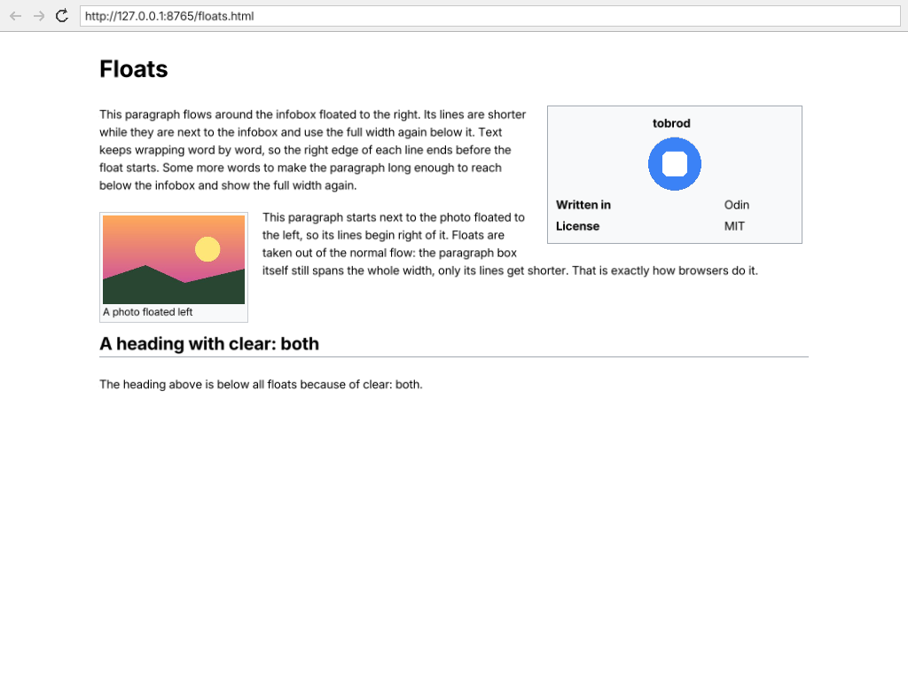
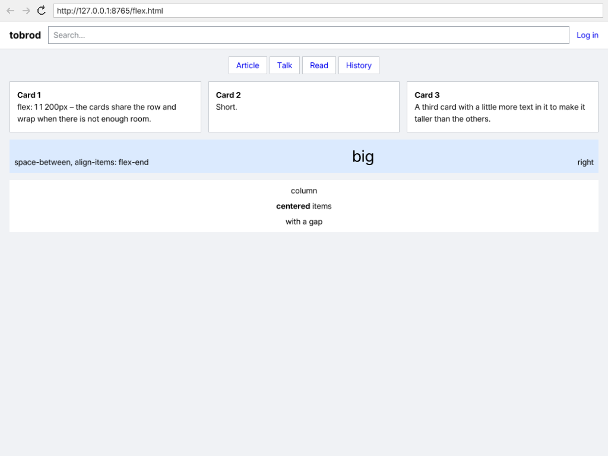
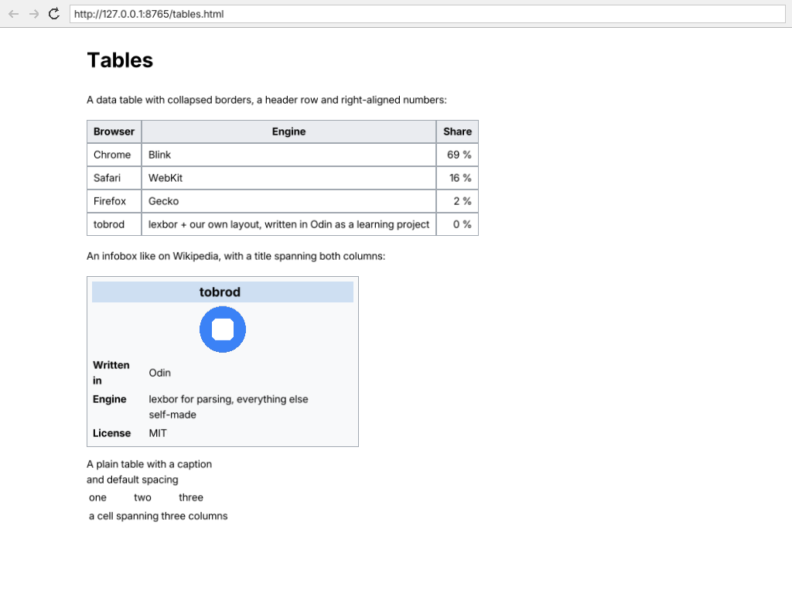

# tobrod – a toy browser in Odin

[](LICENSE)

tobrod is a small web browser written in [Odin](https://odin-lang.org) as a learning project. The goal is to build the parts of a browser step by step and understand how they work: networking, HTML and CSS, layout, rendering, threads and – one day – JavaScript.

HTML and CSS parsing (including selector matching and the cascade) come from [lexbor](https://github.com/lexbor/lexbor), networking from [libcurl](https://curl.se) and windowing/drawing from [raylib](https://www.raylib.com), all through small hand-written Odin bindings. Everything after parsing is tobrod's own code: the DOM tree, computed styles, the layout engine, the display list and the UI.

It is a toy: it renders many real pages surprisingly well (try a Wikipedia article), but it is neither complete nor safe for everyday browsing.

<p align="center">
  
  
  
</p>

## What works

- **Networking**: HTTP(S) via libcurl, redirects, relative URLs, a User-Agent; loading and parsing run on a worker thread, so the window stays responsive (loading bar, stop button)
- **Navigation**: address bar, clickable links, back / forward / reload with a session history (also Alt+←/→, F5, Ctrl+R, Escape to stop)
- **HTML**: parsed by lexbor into tobrod's own DOM tree; plain text documents are shown like in Chrome
- **CSS**: `<style>`, `style=""` and external stylesheets, `@media` queries, custom properties (`var()`), inheritance and the user agent defaults
- **Layout**: block and inline layout with margin collapsing, the box model (margin, padding, borders, width / max-width, `margin: auto`), backgrounds, `text-align`, lists, images, tables, floats and flexbox
- **Rendering**: text in regular and bold [Inter](https://github.com/rsms/inter) with sizes and colors, boxes, borders, images (PNG, JPG, GIF, BMP, QOI)

See the [roadmap](#roadmap) for the details and [known limitations](#known-limitations) for what's missing.

## Building

You need the [Odin compiler](https://odin-lang.org/docs/install/) (tested with `dev-2026-05` on Windows and `dev-2026-09` on macOS). Clone with the submodules – curl and lexbor are built from source on Windows:

```sh
git clone --recursive https://github.com/soerenlemke/tobrod.git
cd tobrod
```

### Windows

Install CMake and the Visual Studio Build Tools (MSVC), then build curl and lexbor once:

```powershell
.\setup.ps1
```

Both are built as static libraries with the dynamic CRT (`/MD`), which is what `vendor:raylib` needs. That's also why tobrod uses its own copy of the curl bindings instead of Odin's `vendor:curl`.

### macOS

```sh
brew install curl mbedtls lexbor
```

### Linux

The bindings link `system:curl` and `system:lexbor`, but Linux is not tested yet.

### Run

Always run from the repository root (the fonts are loaded from `assets/fonts/`):

```sh
odin run .
```

## Usage

Type a URL into the address bar and press Enter. Command line options:

| Option | |
|---|---|
| `--url <url>` | load this URL on startup |
| `--screenshot <file.png>` | wait until the page (and its images) has loaded, save a PNG of the window and exit |
| `--scroll <px>` | with `--screenshot`: scroll down this far first |

The screenshot mode is used for visual tests with the pages in [testdata/](testdata/):

```sh
python -m http.server 8765 --bind 127.0.0.1 --directory testdata
odin build . && ./tobrod --url http://127.0.0.1:8765/floats.html --screenshot screenshots/floats.png
```

## Tests

```sh
odin test dom            # DOM, styles, @media, var()
odin test layout         # layout engine, with a fake text measurement (no window)
odin test loader         # worker thread, against a small local HTTP server
odin test http
odin test browser        # history
odin test ui
odin test vendor/lexbor  # the lexbor bindings
```

## How it fits together

```
main → browser → ui → layout → dom → vendor/lexbor
             └→ loader → http → vendor/curl
```

| Package | |
|---|---|
| `http` | GET requests with libcurl, URL resolution |
| `loader` | worker thread: downloads pages and images, parses pages (incl. external stylesheets) |
| `dom` | tobrod's own DOM tree and computed styles (cascade from lexbor, `@media`, `var()`, our value parsers) |
| `layout` | turns the styled DOM into a display list: boxes, text runs and images with positions |
| `ui` | raylib window: address bar, navigation buttons, page view that draws the display list |
| `browser` | connects everything: navigation, history, loading |

The detailed developer notes (in German) are in [CLAUDE.md](CLAUDE.md).

## Known limitations

- no JavaScript yet
- no SVG or WebP images, no video playback (the poster image is shown)
- fonts: only Latin characters (Latin-1 and a few more); other scripts show `?`
- layout: no CSS grid, no `height` on blocks, `position: absolute/fixed` elements are hidden instead of placed, no `rowspan`
- `@media` queries are evaluated once, for the window size at load time
- no forms, no text selection, no tabs, no cookies

## Roadmap

Stage 1 — HTTP client

- [x] GET requests via libcurl bindings (`vendor/curl`)
- [x] Response headers, error handling, connection reuse
- [x] Redirects, User-Agent, relative URLs (curl's URL API)

Stage 2 — Window & UI

- [x] Window via `vendor:raylib`
- [x] Address bar
- [x] Clickable links
- [x] Back, forward, reload with a session history; keyboard shortcuts
- [ ] Complete URLs without a scheme (`example.com` → `https://example.com`)
- [ ] Tabs

Stage 3 — Text rendering

- [x] Text rendering, wrapping, scrolling
- [x] Regular and bold font, sizes, colors

Stage 4 — HTML & CSS

- [x] lexbor bindings: parsing, DOM traversal, node data, CSS cascade
- [x] Own DOM tree
- [x] `<style>`, `style=""` and external stylesheets
- [x] `@media` queries
- [x] CSS custom properties (`var()`)
- [x] Computed styles: display, colors, fonts, box model, visibility, list-style, position, float, flex
- [x] Layout: blocks, inline text, margin collapsing, box model, backgrounds, borders, `text-align`, lists
- [x] Images (and other replaced elements like `video`, `iframe`)
- [x] Tables
- [x] Floats
- [x] Flexbox
- [ ] CSS grid
- [ ] Positioned elements (`absolute`, `fixed`, `sticky`)
- [ ] SVG

Stage 5 — Threads

- [x] Load and parse pages and images on a worker thread
- [x] Hand results to the ui (queue with mutex and condition variable, polled once per frame)
- [x] One curl handle per thread; cancelling via an atomic flag
- [x] Loading indicator and stop button

Stage 6 — JavaScript

- [ ] Bind QuickJS as the JavaScript engine
- [ ] Connect it to the DOM
- [ ] Basic DOM manipulation from JavaScript

## Development

tobrod is a hobby and learning project. Much of it was developed together with an AI assistant (Claude); the commits show this with a `Co-Authored-By` line.

## License

tobrod's own code is licensed under the [MIT License](LICENSE).

Third-party parts keep their own licenses:

| | License |
|---|---|
| [Inter](https://github.com/rsms/inter) font in `assets/fonts/` | SIL Open Font License 1.1, see [assets/fonts/OFL.txt](assets/fonts/OFL.txt) |
| curl bindings in `vendor/curl/` (modified copy of Odin's `vendor:curl`) | zlib license (Odin), see [vendor/curl/LICENSE-odin](vendor/curl/LICENSE-odin) |
| curl headers in `vendor/curl/c/` and the [curl](https://curl.se) submodule | curl license, see [vendor/curl/LICENSE](vendor/curl/LICENSE) |
| [lexbor](https://github.com/lexbor/lexbor) submodule (v3.0.1) | Apache License 2.0 |
| [raylib](https://www.raylib.com) (via Odin's `vendor:raylib`) | zlib license |

The test images in `testdata/images/` were generated for this project and fall under the MIT license.
